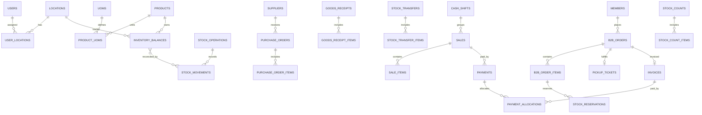

# BLUEPRINT TEKNIS — LARAVEL 12 + MYSQL
## Sistem Manajemen Operasional Pasar Terpadu
**Versi:** 1.0, pendamping PRD v2.0  
**Tanggal:** 24 Oktober 2026  
**Status:** Desain teknis usulan; belum mengeksekusi migration atau mengubah source code existing

> Dokumen ini menerjemahkan kebutuhan PRD v2 menjadi arsitektur kode dan model database yang dapat diturunkan menjadi Laravel migrations, Eloquent models, actions/services, policies, dan tests. Detail file frontend/template existing serta database yang sudah aktif belum tersedia, jadi nama komponen/UI di sini adalah kontrak fungsional, bukan asumsi kode yang sudah ada.

---

## 1. Keputusan arsitektur
| Aspek | Keputusan | Alasan |
|---|---|---|
| Pola | **Modular Monolith** satu aplikasi Laravel 12 | Batas modul jelas, deploy sederhana, transaksi ACID antar modul |
| Database | MySQL 8.x InnoDB; direkomendasikan MySQL 8.4 LTS untuk deployment baru | Transaksi, row locking, FK, index dan backup matang |
| Frontend | **Pertahankan** stack/UI template Laravel yang saat ini aktif | Tidak membuang layout, komponen, style, dan fitur yang telah dibuat |
| Business logic | Use-case `Actions` / domain `Services` per modul | Menghindari aturan bisnis tersebar pada controller/komponen UI |
| HTTP | Controller tipis, FormRequest, Policy, Resource/ViewModel | Pemisahan validasi/izin dan proses |
| Data | Eloquent untuk entitas, query builder untuk agregasi/read model kompleks | Seimbang antara kemudahan dan performa |
| Auth | Gunakan auth existing; tambah permission granular dan multi-lokasi | Tidak memaksa reinstall autentikasi |
| Event | Domain events setelah transaksi commit; outbox jika integrasi kritis | Menghindari notifikasi saat database rollback |
| Queue | Database queue sudah cukup di awal; Redis opsional ketika beban meningkat | Minimal infrastruktur permulaan |
| Files | Private disk melalui Laravel Storage | Bukti nota, hasil opname dan ekspor dapat dikontrol aksesnya |
| Realtime | Polling pendek/SSE/broadcast sesuai stack existing; transaksi tetap source of truth di server | UI cepat tanpa bergantung pada WebSocket untuk integritas data |

**Non-goal awal:** microservices, event sourcing penuh, offline POS tanpa mekanisme sinkronisasi konflik, full general ledger akuntansi, dan membangun ulang seluruh frontend.

---

## 2. Bounded contexts/modul

```text
Identity & Access ───────────────────────┐
Master Data (Product, UOM, Location) ────┤
Purchasing (PO, Receipt, Emergency) ────>│
Inventory (Balances, Ledger, Reserve) <──┼── POS (Sale, Cash Shift, Refund)
Transfer (Dispatch, Receive) ───────────>│
Pricing & Costing ──────────────────────>│
B2B (Member, Order, Credit) ────────────>│
Fulfillment (Picking, Pickup QR) ───────>│
Stock Count (Opname) ────────────────────>│
Reporting, Anomaly, Audit <──────────────┘
```

**Sumber data terpusat:** `InventoryService` saja yang menulis saldo dan mutasi stok. Purchasing/Transfer/POS/B2B/Opname memanggil operasi domain; dilarang `InventoryBalance::update()` langsung dari controller/komponen. `CostingService` menghitung perolehan, perpindahan dan COGS. `CreditPolicyService` menghitung eksposur kredit, dan `PricingService` memvalidasi harga server-side.

---

## 3. Struktur folder Laravel yang direkomendasikan
Ini adalah salah satu struktur yang kompatibel dengan Laravel, bukan persyaratan framework. Jika proyek sudah memakai struktur lain, **adaptasi tanpa memindahkan file secara massal**.

```text
app/
├── Domain/
│   ├── Identity/
│   │   ├── Actions/   Models/   Policies/   DTOs/
│   ├── Catalog/
│   │   ├── Actions/   Models/   Services/   DTOs/
│   ├── Purchasing/
│   │   ├── Actions/   Models/   Events/   DTOs/
│   ├── Inventory/
│   │   ├── Actions/   Models/   Services/   Exceptions/
│   ├── Transfers/
│   │   ├── Actions/   Models/   DTOs/
│   ├── Pricing/
│   │   ├── Services/  Rules/    Models/
│   ├── PointOfSale/
│   │   ├── Actions/   Models/   Services/   DTOs/
│   ├── MembersB2B/
│   │   ├── Actions/   Models/   Services/   DTOs/
│   ├── Fulfillment/
│   │   ├── Actions/   Models/   Services/
│   ├── StockCount/
│   │   ├── Actions/   Models/   Services/
│   └── Reporting/
│       ├── Queries/   ReadModels/  Events/
├── Http/
│   ├── Controllers/      # dikelompokkan per domain/role bila perlu
│   ├── Requests/         # validasi payload
│   ├── Resources/        # respons JSON bila ada API
│   └── Middleware/       # locale & active location
├── Support/
│   ├── Money/            # pembulatan dan decimal helpers
│   ├── Audit/            # pencatatan audit
│   ├── Idempotency/      # request replay prevention
│   └── UI/               # view models dan formatters
├── Jobs/  Events/  Listeners/  Providers/
└── Models/User.php       # dapat dipertahankan dari app existing

routes/
├── web.php               # boleh impor routes modular
├── api.php               # opsional; tidak diasumsikan sudah terpasang
└── modules/              # admin.php, inventory.php, pos.php, b2b.php

resources/
├── views/                # jika existing menggunakan Blade
├── js/                   # jika template menggunakan Inertia/Vue/React
├── css/                  # existing Tailwind/CSS variables
└── lang/                 # lokasi menyesuaikan proyek Laravel saat ini

database/
├── migrations/           # kelompokkan prefiks waktu/dependency
├── seeders/
└── factories/

tests/
├── Unit/                 # biaya, konversi, pricing dan credit
├── Feature/              # alur, izin, form dan API
└── Integration/          # concurrency / MySQL-specific tests
```

**Contoh naming use case:** `PostGoodsReceipt`, `DispatchTransfer`, `ReceiveTransfer`, `CheckoutSale`, `ReserveB2BOrder`, `RedeemPickupTicket`, `FinalizeStockCount`, `VoidSale`. Setiap action mempunyai satu entry point dan hasil deterministik.

---

## 4. Konvensi database yang disarankan
- Nama tabel plural `snake_case`, nama FK `<entity>_id`, unique business key per entitas (`sku`, `order_number`, `receipt_number`, `invoice_number`).
- Primary key `BIGINT UNSIGNED` (`id` Laravel default); `UUID/ULID` boleh sebagai `public_id` untuk URL/QR yang tidak mudah ditebak.
- `created_at`, `updated_at` untuk dokumen mutable; `posted_at`, `finalized_at`, `cancelled_at`, `deleted_at` hanya bila relevan.
- `DECIMAL(18,3)` untuk kuantitas default; bila ketelitian produk lebih tinggi gunakan konfigurasi presisi terencana, **bukan FLOAT**. `DECIMAL(20,6)` untuk `unit_cost`, `DECIMAL(20,2)` untuk uang transaksi dan `factor_to_base` `DECIMAL(20,6)`.
- Nilai negatif hanya pada `stock_movements.delta_qty_base`; saldo tersedia tidak negatif pada operasi normal.
- Semua FK yang terkait histori transaksi menggunakan **RESTRICT/NO ACTION** untuk delete; master di-nonaktifkan (`is_active`) alih-alih menghapus data.
- `CHECK` dapat dipakai untuk invariants sederhana yang didukung versi MySQL deployment; kompleksitas lintas tabel ditegakkan oleh action dan integration tests.
- Kode status terkontrol melalui enum PHP/value object dan validasi aplikasi; kolom MySQL bertipe `VARCHAR` plus index atau enum database dengan konsekuensi migrasi yang dipertimbangkan.
- `JSON` untuk metadata fleksibel, **bukan** untuk roles, permissions, item order, atau sumber utama saldo.
- Index mengikuti filter nyata: `(location_id, product_id)` pada saldo, `(member_id, status)` pada order, `(location_id, created_at)` pada movements, `(status, due_date)` pada invoice.
- Tanggal simpan secara konsisten; format JSON API ISO-8601, zona waktu tampilan Asia/Jakarta.

---

## 5. Blueprint skema relasional
Kolom di bawah adalah **kolom penting**, bukan seluruh field audit/default. Seluruh entitas transaksi diberi actor/timestamp sesuai kebutuhan. Angka/constraint yang belum disepakati ditandai untuk konfigurasi.

### 5.1 Identity, lokasi, dan master data
| Tabel | Field inti | Relasi dan constraint |
|---|---|---|
| `users` | `id`, `name`, `username`, `email?`, `password`, `preferred_locale`, `is_active` | `username` UNIQUE; password mengikuti Laravel auth existing |
| `roles` | `id`, `name` | UNIQUE `name`; dapat memakai skema paket RBAC kompatibel |
| `permissions` | `id`, `name` | UNIQUE `name`; contoh `stock.count.finalize` |
| `user_roles`, `role_permissions`, `user_permissions` | masing-masing FK user/role/permission | Pivot composite UNIQUE; nama sesuaikan paket bila dipakai |
| `locations` | `id`, `code`, `name`, `type`, `parent_id?`, `is_active` | UNIQUE code; type `WAREHOUSE/STORE/TRANSIT` |
| `user_locations` | `user_id`, `location_id`, `is_default` | UNIQUE `(user_id,location_id)` |
| `product_categories` | `id`, `parent_id?`, `name`, `code`, `is_active` | UNIQUE code; tree dapat sederhana |
| `uoms` | `id`, `code`, `name`, `symbol`, `dimension`, `precision` | code UNIQUE; kg/pcs/liter; cegah lintas dimensi |
| `products` | `id`, `sku`, `name`, `normalized_name`, `category_id`, `base_uom_id`, `is_active`, `track_stock` | sku UNIQUE, FK kategori dan UOM; **tanpa** `current_hpp` global |
| `product_uoms` | `id`, `product_id`, `uom_id`, `factor_to_base`, `barcode?`, `is_purchase`, `is_sale`, `is_base` | UNIQUE `(product_id,uom_id)`; barcode global UNIQUE bila ada; factor >0 |
| `suppliers` | `id`, `supplier_code`, `name`, `phone?`, `address?`, `is_active` | code UNIQUE; data pedagang ad hoc bisa snapshot |
| `members` | `id`, `member_code`, `name`, `type`, `tier_id?`, `credit_limit`, `phone?`, `address?`, `is_active` | member_code UNIQUE; credit_limit >=0; **tanpa** `current_debt` editable |
| `member_tiers` | `id`, `code`, `name`, `priority`, `is_active` | mis. Silver/Gold/VIP; code UNIQUE |
| `member_users` | `member_id`, `user_id`, `contact_role` | Pivot akun portal; pembatasan order mitra |

**Catatan:** jika aplikasi saat ini sudah memakai tabel `users`/roles, migrasi harus bersifat **aditif** dan dipetakan, bukan mengganti tabel auth tanpa analisis.

### 5.2 Pricing dan inventory (sumber kebenaran stok)
| Tabel | Field inti | Relasi dan constraint |
|---|---|---|
| `pricing_policies` | `id`, `scope`, `location_id?`, `channel`, `min_markup_type`, `min_markup_value`, `effective_from`, `effective_to?` | Definisi floor markup dan versi kebijakan |
| `price_rules` | `id`, `product_id`, `location_id?`, `channel`, `tier_id?`, `list_price`, `market_min_price?`, `market_max_price?`, `effective_from`, `effective_to?` | Index `(product_id,location_id,channel,tier_id)`; cegah effective interval overlap di service |
| `inventory_balances` | `id`, `location_id`, `product_id`, `on_hand_qty`, `reserved_qty`, `avg_unit_cost`, `version` | UNIQUE `(location_id,product_id)`; FK lokasi & produk; saldo dimutasi lewat service |
| `stock_operations` | `id`, `operation_uuid`, `operation_type`, `document_type`, `document_id`, `posted_at`, `actor_user_id`, `idempotency_key?` | operation_uuid UNIQUE; `(operation_type,document_type,document_id)` UNIQUE bila satu posting per dokumen |
| `stock_movements` | `id`, `operation_id`, `location_id`, `product_id`, `delta_qty_base`, `unit_cost_snapshot`, `amount_value`, `movement_type`, `semantic_status`, `occurred_at` | Append-only; index `(product_id,location_id,occurred_at)`; tiap pemindahan dua atau lebih baris ledger |
| `stock_reservations` | `id`, `order_item_id`, `location_id`, `product_id`, `qty_base`, `status`, `released_at?`, `fulfilled_at?` | UNIQUE `(order_item_id,location_id)` dalam MVP; hanya order aktif mengikat reserved |
| `stock_cost_layers` **opsional** | `id`, `location_id`, `product_id`, `source_type`, `source_id`, `received_qty`, `received_unit_cost` | Untuk audit sumber perolehan; **bukan** FIFO jika metode HPP moving average |

**Invarian wajib:** `balance.on_hand_qty = SUM(stock_movements.delta_qty_base)` sejak opening balance/cutover per lokasi-produk. `reserved_qty = SUM(active stock_reservations.qty_base)`. Jalankan rekonsiliasi periodik otomatis dan laporkan selisih jika terjadi bug/manual DB edit. Seed saldo awal **lewat opening balance operation**, bukan update manual tanpa ledger.

### 5.3 Purchasing, penerimaan, emergency, transfer
| Tabel | Field inti | Relasi dan constraint |
|---|---|---|
| `purchase_orders` | `id`, `po_number`, `supplier_id`, `destination_location_id`, `status`, `ordered_at`, `created_by` | po_number UNIQUE |
| `purchase_order_items` | `id`, `purchase_order_id`, `product_id`, `product_uom_id`, `quantity_ordered`, `factor_to_base_snapshot`, `unit_purchase_price`, `quantity_received_base` | FK PO/produk/UOM; qty received boleh derived/read model |
| `goods_receipts` | `id`, `receipt_number`, `receipt_type`, `po_id?`, `supplier_id?`, `supplier_name_snapshot?`, `location_id`, `status`, `posted_at`, `created_by` | receipt_type `PO/EMERGENCY`; nomor unik; emergency wajib bukti |
| `goods_receipt_items` | `id`, `goods_receipt_id`, `po_item_id?`, `product_id`, `product_uom_id`, `qty_input`, `factor_snapshot`, `qty_base`, `unit_cost_base`, `line_total` | FK; line_total mencakup skema biaya perolehan yang disepakati |
| `stock_transfers` | `id`, `transfer_number`, `from_location_id`, `to_location_id`, `transit_location_id`, `status`, `dispatched_at?`, `received_at?`, `created_by` | Asal ≠ tujuan; nomor UNIQUE |
| `stock_transfer_items` | `id`, `transfer_id`, `product_id`, `requested_qty_base`, `dispatched_qty_base`, `received_qty_base`, `cost_snapshot` | Status parsial & selisih dicatat |
| `attachments` | `id`, `document_type`, `document_id`, `disk`, `storage_path`, `mime_type`, `size_bytes`, `uploaded_by` | File privat; referensi dokumen melalui service; tanpa URL publik |

**Aksi:** `PostGoodsReceipt` (menambah saldo/cost) dan `DispatchTransfer`/`ReceiveTransfer` (ledger asal, transit, tujuan). Transfer tidak mempengaruhi laba; cost membawa sumber nilai tanpa revaluasi fiktif.

### 5.4 POS dan pengelolaan kasir
| Tabel | Field inti | Relasi dan constraint |
|---|---|---|
| `cash_shifts` | `id`, `location_id`, `cashier_user_id`, `status`, `opened_at`, `closed_at?`, `opening_cash`, `expected_cash?`, `counted_cash?`, `discrepancy?`, `validated_by?` | Satu shift aktif per kasir/laci sesuai aturan; index status |
| `sales` | `id`, `sale_number`, `location_id`, `cash_shift_id`, `member_id?`, `status`, `subtotal`, `discount_total`, `tax_total`, `grand_total`, `cogs_total`, `posted_at`, `cashier_user_id` | sale_number UNIQUE; status `DRAFT/PAYMENT_PENDING/POSTED/VOIDED` |
| `sale_items` | `id`, `sale_id`, `product_id`, `product_uom_id`, `qty_input`, `factor_snapshot`, `qty_base`, `unit_selling_price`, `discount`, `unit_cost_snapshot`, `line_total`, `cogs_total` | Cost snapshot immutable after posted |
| `payments` | `id`, `payment_number`, `sale_id?`, `member_id?`, `method`, `status`, `amount`, `provider_reference?`, `received_at?`, `created_by` | `method CASH/QRIS/TRANSFER/...`; UNIQUE provider_ref bila disediakan; split = beberapa rows |
| `refunds` | `id`, `refund_number`, `original_sale_id`, `location_id`, `reason`, `status`, `posted_at`, `created_by` | Refund mereferensi sale, bukannya menghapus sale |
| `refund_items` | `id`, `refund_id`, `sale_item_id`, `qty_base`, `refund_amount`, `restock_condition`, `cost_snapshot` | Hindari refund qty kumulatif > original terjual |

**Catatan:** void sebelum pembayaran terposting dapat membatalkan draft tanpa stok; void setelah POSTED harus membuat event reversal stok/keuangan yang jelas. Penagihan QRIS asynchronous: `PAYMENT_PENDING` sampai bukti berhasil diverifikasi server/gateway.

### 5.5 B2B, kredit, invoice dan serah-terima
| Tabel | Field inti | Relasi dan constraint |
|---|---|---|
| `b2b_orders` | `id`, `order_number`, `member_id`, `sales_user_id?`, `fulfillment_location_id`, `payment_terms`, `status`, `subtotal`, `grand_total`, `placed_at`, `expires_at?` | order_number UNIQUE; payment_terms `PREPAID/CREDIT` |
| `b2b_order_items` | `id`, `order_id`, `product_id`, `product_uom_id`, `qty_input`, `factor_snapshot`, `qty_base`, `unit_selling_price`, `discount`, `line_total` | harga ditetapkan saat placed |
| `pickup_tickets` | `id`, `ticket_number`, `order_id`, `location_id`, `token_hash`, `status`, `expires_at`, `redeemed_at?`, `redeemed_by?` | ticket/order/token_hash UNIQUE untuk satu pickup per order MVP |
| `invoices` | `id`, `invoice_number`, `member_id`, `order_id`, `status`, `issued_at`, `due_at?`, `amount_total`, `amount_paid`, `amount_outstanding` | invoice_number UNIQUE; outstanding derived/materialized sesuai kebijakan |
| `invoice_items` | `id`, `invoice_id`, `order_item_id?`, `description`, `qty_base`, `unit_price`, `line_total`, `unit_cost_snapshot?` | Snapshot dokumen jual |
| `payment_allocations` | `id`, `payment_id`, `invoice_id`, `allocated_amount`, `allocated_at` | Nilai alokasi ≤ pembayaran tersedia dan outstanding invoice |
| `credit_exposure_reservations` | `id`, `order_id`, `member_id`, `reserved_amount`, `status`, `released_at?` | order_id UNIQUE; mencegah dua order bersamaan melewati limit |

**Definisi piutang:** invoice posted yang belum dilunasi (kurangi refund/credit note yang valid). Jangan menjumlahkan order sudah invoiced sebagai exposure kedua kalinya. `amount_paid/outstanding` boleh disimpan sebagai cache terkontrol oleh layanan pembayaran, tetapi harus direkonsiliasi terhadap alokasi dan reversal.

### 5.6 Stock opname, audit, anomali dan kas operasional
| Tabel | Field inti | Relasi dan constraint |
|---|---|---|
| `stock_counts` | `id`, `count_number`, `location_id`, `status`, `scope`, `opened_by`, `opened_at`, `finalized_by?`, `finalized_at?`, `loss_value` | count_number UNIQUE |
| `stock_count_items` | `id`, `stock_count_id`, `product_id`, `baseline_qty`, `baseline_at`, `physical_qty?`, `expected_qty_at_count?`, `counted_at?`, `counted_by?`, `diff_qty?`, `reason_code?`, `notes?` | UNIQUE `(stock_count_id,product_id)` MVP; revisi hitung lewat count attempts bila perlu |
| `stock_count_attempts` **opsional** | `id`, `count_item_id`, `physical_qty`, `counted_by`, `counted_at`, `version` | Mendukung audit recount, hindari overwrite angka hitung |
| `audit_logs` | `id`, `actor_user_id?`, `actor_role_snapshot`, `location_id?`, `action`, `auditable_type`, `auditable_id`, `before_json?`, `after_json?`, `metadata_json?`, `occurred_at` | Append-only; filter actor/action/date; jangan simpan password/token |
| `anomaly_events` | `id`, `severity`, `kind`, `location_id?`, `actor_user_id?`, `reference_type`, `reference_id`, `amount?`, `occurred_at`, `acknowledged_at?` | Laporan Owner; penandaan baca bukan approval |
| `idempotency_keys` | `id`, `scope`, `key_hash`, `request_hash`, `result_reference`, `status`, `created_at`, `expires_at` | UNIQUE `(scope,key_hash)`; request berbeda dengan key sama harus ditolak |
| `system_settings` | `id`, `key`, `value_json`, `updated_by` | key UNIQUE; konfigurasi global; perubahan diaudit |
| `cash_accounts` **perlu untuk arus kas** | `id`, `location_id?`, `type`, `name`, `is_active` | Jenis kas/laci, bank, settlement |
| `cash_movements` **perlu untuk arus kas** | `id`, `cash_account_id`, `direction`, `amount`, `reference_type`, `reference_id`, `occurred_at` | Penerimaan/keluaran kas; audit refund, belanja emergency, setoran |
| `expense_entries` **fase lanjutan** | `id`, `location_id`, `category_id?`, `cash_account_id?`, `amount`, `expense_date`, `reference` | Dibutuhkan jika ingin laba bersih, bukan hanya laba kotor |
| `outbox_events` **opsional** | `id`, `event_id`, `type`, `aggregate_type`, `aggregate_id`, `payload`, `published_at?` | Publikasi durable untuk integrasi penting |

**Keterbatasan akuntansi:** PRD awal menyebut **laba-rugi dan arus kas**. Dengan modul di atas, MVP bisa menampilkan omzet, HPP, laba kotor, penerimaan kas dan pembayaran operasional yang **tercatat di aplikasi**. Laporan laba bersih dan laporan arus kas yang lengkap memerlukan pencatatan biaya, hutang pemasok, kewajiban pajak, bank settlement, dan aturan akuntansi tambahan; jangan menampilkan label "laba bersih" dari `sales - cogs` saja.

### 5.7 Relasi utama (ERD ringkas)



ERD hanya menampilkan hubungan penting. Beberapa relasi operasional tidak ditarik agar tetap terbaca; `INVENTORY_BALANCES ↔ STOCK_MOVEMENTS` adalah hubungan melalui `(location_id, product_id)`, **bukan FK langsung**.

---

## 6. State machine yang harus diuji

| Entitas | State sah ringkas | Guard / efek samping |
|---|---|---|
| Receipt | `DRAFT → POSTED`, atau `CANCELLED` | POSTED menambah stok+cost tepat sekali |
| Transfer | `DRAFT → DISPATCHED → PARTIALLY_RECEIVED/RECEIVED` | Dispatch pindah ke transit; receive pindah ke tujuan |
| POS sale | `DRAFT → PAYMENT_PENDING → POSTED` atau `CANCELLED`; `POSTED → VOIDED` lewat reversal | Tidak boleh checkout kedua pada idempotency key yang sama |
| B2B order | `DRAFT → PLACED → RESERVED → PICKING → READY_FOR_PICKUP → HANDED_OVER` | Reserve sebelum pickup; release jika expired/cancelled |
| Pickup ticket | `ISSUED → REDEEMED`, atau `EXPIRED/REVOKED` | Token unik, lokasi dan order cocok, consume atomik |
| Invoice | `OPEN → PARTIALLY_PAID → PAID` dan `OVERDUE` sebagai kondisi berbasis due date | pembayaran tidak boleh dialokasikan dua kali |
| Opname | `OPEN → COUNTING → RECONCILIATION → FINALIZED` | Blind count tidak mengungkap system qty; diff harus beralasan |
| Cash shift | `OPEN → CLOSED → VALIDATED` | selisih direkam, bukan mengedit penerimaan lama |

**Status `OVERDUE`:** sebaiknya dianggap kondisi `due_at < now && outstanding > 0`, bukan status yang bergantung pada scheduler tepat waktu. Scheduler boleh menyimpan flag untuk pencarian cepat.

---

## 7. Pola transaksi database yang wajib
### 7.1 Prinsip umum
1. Mulai `DB::transaction()` pada setiap proses finansial/stok yang melibatkan >1 baris/tabel.
2. Tentukan **urutan locking konsisten** (misal `location_id, product_id` ascending) untuk mengurangi deadlock.
3. Ambil `lockForUpdate()` pada `inventory_balances` yang relevan dan baris `members` saat reservasi kredit.
4. Validasi saldo, harga, izin dan transisi status **setelah lock diperoleh**; front-end checks hanya kenyamanan UX.
5. Buat dokumen final + ledger + update balance + audit/anomaly **dalam transaksi yang sama**.
6. External payment gateway, upload besar dan proses jaringan **tidak** dilakukan di tengah transaksi terkunci.
7. Perintah posting menerima `idempotency_key` unik, sehingga retry karena timeout tidak menduplikasi pekerjaan.
8. Kirim event/UI broadcast atau queue notification **setelah commit**, bukan saat data belum final.
9. Jika deadlock, retry transaksi terbatas; permintaan idempotent aman untuk diulang.

### 7.2 Contoh kerangka Laravel untuk pengurangan stok
**Ilustrasi saja, bukan kode siap tempel.** Anggap permission, idempotency, payment, dan sale document ditangani oleh action di lapisan pemanggil.

```php
use Illuminate\Support\Facades\DB;
use App\Domain\Inventory\Models\InventoryBalance;
use App\Domain\Inventory\Models\StockMovement;

DB::transaction(function () use ($locationId, $productId, $qtyBase, $operationId, $unitCost) {
    $balance = InventoryBalance::query()
        ->where('location_id', $locationId)
        ->where('product_id', $productId)
        ->lockForUpdate()
        ->firstOrFail();

    $available = $balance->on_hand_qty - $balance->reserved_qty;
    if ($qtyBase <= 0 || $available < $qtyBase) {
        throw new DomainException('Stok tersedia tidak mencukupi.');
    }

    $balance->on_hand_qty = $balance->on_hand_qty - $qtyBase;
    $balance->save();

    StockMovement::create([
        'operation_id' => $operationId,
        'location_id' => $locationId,
        'product_id' => $productId,
        'delta_qty_base' => -$qtyBase,
        'unit_cost_snapshot' => $unitCost,
        'movement_type' => 'SALE_POS',
        'semantic_status' => 'outbound',
        'occurred_at' => now(),
    ]);
}, attempts: 3);
```

**Perhatian khusus decimal:** contoh PHP melakukan operasi sederhana agar mudah dibaca. Untuk produksi, hindari perhitungan pecahan uang dengan binary float; gunakan decimal-string arithmetic, integer minor unit yang cocok, atau operasi DECIMAL di database yang teruji. Perhitungan `unit_cost` dan pembulatan harus dilakukan oleh `CostingService`.

### 7.3 Checkout POS — urutan logis
```
Receive checkout(key)
  -> verify user, shift, location and payment state
  -> get/create idempotent request record
  -> begin DB transaction
      -> lock all inventory balance rows (sorted)
      -> re-evaluate price floor and available stock
      -> create posted sale & sale items with cost snapshots
      -> write payment records verified as received
      -> decrement inventory and write movement ledger
      -> write audit and anomaly if relevant
  -> commit
  -> dispatch receipt printing/notification after commit
  -> return sale number and payment status
```

Untuk gateway QRIS/transfer asynchronous, `PAYMENT_PENDING` tidak menjadi sale posted sampai aturan pembayaran terpenuhi; jika reservasi stok sementara digunakan, tetapkan expiry dan proses release teruji.

### 7.4 Reservasi kredit B2B — urutan logis
```
Create order
  -> lock member row (FOR UPDATE)
  -> calculate invoiced outstanding + un-invoiced active credit exposure
  -> check overdue invoices
  -> lock product-location stock rows in consistent order
  -> check available stock and server-side tier prices
  -> create order/order_items + stock_reservations
  -> increment reserved balances
  -> create credit_exposure_reservation for credit terms
  -> commit
```

### 7.5 Redeem pickup QR — urutan logis
```
Verify authenticated staff + source location + token hash
  -> begin transaction
  -> lock ticket and order
  -> ensure ticket ISSUED, not expired, not redeemed
  -> ensure order READY_FOR_PICKUP and fulfillment location matches
  -> lock ordered product balances
  -> convert reservation into stock-out exactly once
  -> ticket REDEEMED; order HANDED_OVER; record actor/time
  -> issue invoice and move credit exposure to receivable
  -> ledger and audit
  -> commit
```

**Kritis:** saat stok sudah reserved, `available = on_hand - reserved` tidak boleh dipakai untuk menolak fulfillment pesanan yang **memiliki reservasi sendiri**. Saat pickup, kurangi **on_hand dan reserved untuk order terkait** dalam transaksi yang sama. Sebelum checkout order baru, perhitungkan seluruh reservasi aktif.

### 7.6 Stock count saat operasional berjalan
Pilihan lebih aman untuk MVP:
- **Mode 1: freeze singkat per SKU/area saat count** (bukan seluruh toko), atau
- **Mode 2: rolling count** dengan pembekuan `expected_qty` pada saat hitung dan deteksi mutasi setelah hitung untuk meminta recount jika validitas terganggu.

Jangan menerapkan `balance = physical_qty` pada finalisasi yang berjarak waktu lama dari count tanpa mempertimbangkan transaksi setelah perhitungan. Untuk finalisasi rolling count, posting adjustment berupa `diff_qty` yang telah diverifikasi ke saldo terbaru, bukan overwrite saldo dengan angka fisik yang usang. Nilai kerugian negatif = `abs(diff_qty) × HPP snapshot` sesuai cost policy.

---

## 8. Rancangan endpoint/use case awal
Format ini berlaku apakah UI memakai web routes, Inertia actions, Livewire methods, atau JSON API; nama route diadaptasi sesuai proyek yang ada.

| Modul | Command/query | Role/perizinan | Response/use case |
|---|---|---|---|
| Produk | `products.index/search`, `products.store` | master view/create | list/filter dan saran duplikat |
| Saldo | `inventory.index`, `inventory.movements` | stock view + location scope | qty on-hand/reserved/available |
| PO | `purchase-orders.store`, `receipts.post` | kepala/staf sesuai tugas | order/receipt tercatat |
| Transfer | `transfers.dispatch`, `transfers.receive` | pengirim/penerima lokasi | stok pindah transit/tujuan |
| Emergency | `emergency-receipts.post` | lokasi+permission khusus | stok naik, bukti tersimpan |
| Harga | `prices.update`, `prices.quote` | kepala toko atau POS quote | harga valid dan floor guard |
| POS | `pos.checkout`, `pos.refunds.store`, `cash-shifts.close` | kasir/izin reversal | satu receipt + audit |
| B2B | `orders.store`, `orders.reserve`, `orders.cancel` | Sales/mitra sendiri | kuantitas reserved, tempo valid |
| Pickup | `pickup-tickets.show`, `pickup-tickets.redeem` | mitra read / staf redeem | sekali pakai; no duplicate |
| Opname | `stock-counts.open`, `.count`, `.reconcile`, `.finalize` | staf count, kepala finalize | blind count → adjustment |
| Owner | `reports.dashboard`, `reports.anomalies`, `reports.audit` | owner/admin read | KPI dan drill-down |

Semua mutating endpoints memakai FormRequest, Policy, throttling jika perlu, dan `Idempotency-Key` untuk aksi posting.

---

## 9. Permission naming convention
Gunakan `resource.action` dan scope ditentukan lewat Policy serta current location, misalnya:

```text
products.view, products.create, products.update
stock.view, stock.movements.view
purchase_orders.create, goods_receipts.post
transfers.dispatch, transfers.receive
emergency_receipts.post
prices.view_cost, prices.update_market, pricing_policies.configure
pos.checkout, pos.refund, pos.void
cash_shifts.open, cash_shifts.close, cash_shifts.validate
members.manage, b2b_orders.create, invoices.view_own
b2b_credit.configure, pickup_tickets.redeem
stock_counts.count, stock_counts.reconcile, stock_counts.finalize
reports.financial.view, reports.anomalies.view
audit.view, settings.manage, users.manage
```

Menu tidak tampil bila tidak memiliki izin, tetapi semua server route tetap memeriksa ability dan access ke `location_id`/`member_id` setiap request.

---

## 10. Standardisasi UI tanpa mengganti template
### 10.1 Audit UI existing sebelum coding fitur
Checklist wajib:
- [ ] Identifikasi stack: Blade+Alpine? Livewire? Inertia+Vue/React? Tailwind? komponen paket?
- [ ] Ambil `desain.md`/style guide dan lokasi `layouts`, `components`, `resources/js`, CSS variables.
- [ ] Dokumentasikan design tokens (background/surface/text/border/spacing/radius/shadow/typography).
- [ ] Identifikasi side navigation, mobile bottom navigation, topbar locale switcher, dark/light mode (jika ada).
- [ ] Cek pola dialog, drawer, table, datagrid, form, toast, loader, empty, search dan pagination.
- [ ] Foto/screenshot halaman existing untuk menyusun baseline visual.
- [ ] Tetapkan komponen shared yang **membungkus komponen eksisting**, bukan membuat sistem komponen kedua.

### 10.2 UI semantic token mapping
| Token semantic | Nilai domain | Mapping UI |
|---|---|---|
| `stock.inbound` | normal masuk | icon `arrow-down-left`, label 'Masuk', aksen hijau yang selaras theme |
| `stock.transfer` | internal/transit | icon `arrow-left-right`, label 'Transfer', aksen biru |
| `stock.sale` | POS/B2B keluar | icon `shopping-cart`, label 'Terjual', aksen ungu |
| `ops.warning` | emergency/near limit | icon `alert-triangle`, label teks dan aksen oranye |
| `ops.critical` | opname minus/void/kas minus | icon `alert-circle`, label teks dan aksen merah |

**Penting:** jangan memakai badge berwarna cerah untuk setiap metadata atau navigasi. Warna harus khusus untuk status bisnis penting; pemakaian template asli tetap prioritas. Teks dan ikon juga harus menyampaikan arti.

### 10.3 Pola layout per area
```
<AppShell (reuse template)>
  <RoleBasedNavigation />
  <PageHeader title actions breadcrumb />
  <ContextBar currentLocation localeSwitcher />
  <ModuleContent>
    <FilterBar />
    <StatCards />
    <DataTable or MobileCards />
    <DetailsDrawer />
  </ModuleContent>
  <ToastHost />
</AppShell>
```

**POS:** header tipis, scan/search cepat, product results, cart selalu terlihat pada tablet landscape, ringkasan bayar sticky, keypad responsif; tidak memuat tabel admin berat. **Gudang:** card/list berfokus scan; langkah fisik maksimal mudah dipahami. **Owner:** KPI + stream exception, bukan spreadsheet penuh pada mobile.

### 10.4 UI i18n
- Kunci terjemahan bersifat domain (`inventory.available`, `pos.pay`, `pickup.ready`).
- String tidak hardcoded ke komponen. Bahasa disimpan per user (`preferred_locale`), fallback ID.
- Tombol ID/EN di header harus menukar label aktif, angka/currency/datetime terformat sesuai locale tanpa mengubah nilai asli.
- Perilaku **tanpa page reload** hanya dapat dipastikan setelah memeriksa stack UI. Untuk Blade tradisional gunakan client i18n state dan partial updates; untuk stack reaktif gunakan mekanisme reactive locale-nya.

### 10.5 Aksesibilitas, scanner, dan motion
- Target sentuh >=48×48px untuk action lapangan, fokus keyboard jelas.
- Scanner mendukung hardware keyboard wedge bila digunakan; camera scanning menggunakan permission browser dan fallback input manual.
- Tombol posting bersifat `loading/disabled` ketika request aktif; backend tetap idempotent.
- Animasi transisi liquid bila ada dari template dipakai seperlunya, bukan untuk saldo real-time atau proses checkout; hormati reduced motion.
- Respons API mengembalikan kode error stabil (contoh `OUT_OF_STOCK`, `BELOW_FLOOR_PRICE`, `CREDIT_LIMIT_EXCEEDED`, `PICKUP_ALREADY_REDEEMED`). UI menerjemahkan pesan berdasar locale.

---

## 11. Urutan migration dan dependensi
1. **Identity foundation:** users existing, roles/permissions existing or new, locations, user_locations.
2. **Catalog:** product_categories, uoms, products, product_uoms, suppliers, member_tiers, members.
3. **Stock foundation:** inventory_balances, stock_operations, stock_movements, stock_reservations, attachments.
4. **Pricing:** pricing_policies, price_rules.
5. **Purchase & transfer:** purchase_orders/items, goods_receipts/items, stock_transfers/items.
6. **POS:** cash_shifts, sales/items, payments, refunds/items.
7. **B2B:** b2b_orders/items, credit_exposure_reservations, pickup_tickets, invoices/items, payment_allocations.
8. **Inventory control:** stock_counts/items, stock_count_attempts (optional).
9. **Platform/reporting:** audit_logs, anomaly_events, idempotency_keys, system_settings, cash_accounts/movements, expenses/outbox optional.

Setiap migration harus memiliki FK/index, reversible `down()` bila aman, dan **tidak menghancurkan** tabel yang sudah dipakai tanpa data migration. Tetapkan baseline schema existing terlebih dahulu; buat mapping lama→baru dan cutover plan bila telah ada data produksi.

---

## 12. Strategi query reporting
- **Transaction tables** = source of truth; dashboard memakai query ringkas atau agregasi/materialized read model dengan watermark waktu `last_calculated_at`.
- **Omzet:** hanya penjualan yang secara kebijakan telah diakui; kurangi refund/void dan diskon terkait, pisahkan POS vs B2B.
- **Laba kotor:** `net sales - SUM(sale/invoice item cogs snapshot)`; tidak menghitung pajak titipan sebagai revenue jika bukan revenue organisasi.
- **Nilai aset stok:** `SUM(on_hand_qty × avg_unit_cost)` lintas gudang+toko+transit sesuai filter; sebutkan kapan transit termasuk.
- **Piutang:** total outstanding invoice valid dikurangi allocation, refund/credit note; tampilkan overdue terpisah.
- **Arus kas operasional:** dari cash movements dan payment settlement yang direkonsiliasi, bukan dari total order.
- **Anomaly feed:** `anomaly_events` dan `audit_logs` disertai `reference_type + id`; filter actor, date, severity, location.
- **Rekonsiliasi:** scheduled job memeriksa balance vs ledger, reserved vs reservations, AR vs payment allocation, dan cash shift vs cash entries.

---

## 13. Validasi, integrasi dan keamanan
1. `FormRequest` untuk input dan `Policy/Gate` untuk semua aksi dan akses records.
2. Sensitive image/private file via authorized controller, URL sementara jika perlu; scan file type dan batasi ukuran.
3. Password hashed sesuai auth Laravel, session regeneration, CSRF, rate limiting, audit login kritis.
4. QR pickup: token CSPRNG, only hash stored, TTL, rekam penggunaan dan rate limit; identitas member QR **tidak cukup** untuk serah-terima tanpa verifikasi order/staf.
5. Jangan simpan QRIS credentials, secret gateway, atau token callback dalam audit JSON.
6. Payment webhook: verifikasi signature/provider reference dan idempotensi; status pembayaran harus mengacu konfirmasi gateway.
7. MySQL backup terjadwal, restore drill di staging, migration dry-run, dan zero-downtime considerations bila sistem aktif.
8. Job retry aman dan mempunyai deduplication/outbox bila berdampak ke eksternal.
9. Cegah mass assignment field biaya/status/aktor pada payload client; actor berasal dari authenticated session.
10. Semua perubahan `system_settings` dan pricing mempunyai version/snapshot agar struk lama tidak berubah.

---

## 14. Testing plan / Quality gates
| Lapisan | Test wajib |
|---|---|
| Unit | faktor UOM, normalisasi produk, HPP moving average, floor, exposure kredit, status transition |
| Feature | CRUD master, akses per lokasi, receipt parsial, emergency evidence, sales checkout, shift, retur, pickup |
| Concurrency | pembelian stok terakhir dari dua kasir, dua order tempo, scan pickup ganda, finalisasi opname bersamaan |
| Database | FK/unique, numeric precision, no negative balance, ledger reconciliation, status idempotency |
| Frontend | konsistensi template, mobile navigation, tablet POS, i18n, scanner fallback, keyboard accessibility |
| Security | B2B IDOR, header auth, file attachment access, role bypass, tampered price, webhook verification |
| Performance | query index pada saldo/stock movement, page filters, response checkout, dashboard agregasi |
| Operations | failed jobs, backup restore, log anomaly, time zone boundary, pembulatan IDR |

**Definition of Done per fitur:** migration + model + policy + request validation + action/use case + tests + UI sesuai template + audit/ledger (jika berpengaruh) + dokumentasi error dan perubahan status.

---

## 15. Backlog teknis berdasarkan prioritas
| Prioritas | Pekerjaan | Keluaran |
|---|---|---|
| P0 | Audit Laravel app, auth, template, DB existing | `CURRENT_STATE.md` dan peta reusable components |
| P0 | Mapping role/permission/location, skema master | desain migration minimal |
| P0 | Inventory balance + immutable movements + stock operation | satu jalur tulis saldo aman |
| P0 | Costing, pricing floor, concurrency & idempotency | stok/HPP/harga akurat |
| P1 | PO/receipts, transfer transit, emergency | gudang↔toko end-to-end |
| P1 | POS, payment records, cash shift | penjualan dan kas audit-ready |
| P1 | B2B, reservation, exposure, invoice, pickup | kredit & order aman |
| P1 | Stock count, audit/anomaly, owner dashboard | kontrol dan pemantauan |
| P2 | Laporan lengkap, queue, backup, observability | hardening operasional |
| P2 | Akuntansi biaya/arus kas lebih komprehensif | laporan keuangan lanjutan |

---

## 16. Referensi teknis yang diperiksa
- Laravel 12 — Database Transactions: https://laravel.com/docs/12.x/database
- Laravel 12 — Directory Structure: https://laravel.com/docs/12.x/structure
- Laravel 12 — Queueable `afterCommit`: https://api.laravel.com/docs/12.x/Illuminate/Bus/Queueable.html
- MySQL 8.4 — InnoDB Locking Reads: https://dev.mysql.com/doc/refman/8.4/en/innodb-locking-reads.html

**Poin penting:** Laravel mendukung `DB::transaction(..., attempts: n)` untuk retry deadlock; InnoDB menyediakan locking reads `SELECT ... FOR UPDATE` dalam transaction. Itu harus menjadi dasar transaksi stok, kredit dan pickup — bukan hanya validasi UI.

---

## 17. Batasan desain dan langkah integrasi proyek nyata
Belum tersedia source code aplikasi Laravel, contoh file template, `desain.md`, migrations existing, tabel produksi, atau kontrak API saat ini. Karena itu:
- **Belum bisa** memastikan class/component Blade/Livewire/Inertia yang sudah tersedia.
- **Belum bisa** memberikan migration final yang aman untuk database existing tanpa inspeksi schema.
- **Belum bisa** mengklaim kesesuaian pixel-perfect UI terhadap template tanpa melihatnya.
- Blueprint ini sengaja menghindari pembuatan kode aplikasi atau file migration yang diam-diam menimpa proyek pengguna.

**Input terbaik untuk fase implementasi:** folder/repository Laravel (atau `composer.json`, `package.json`, `routes/`, `resources/`, `app/`, dan `database/migrations`), `desain.md`, dan 2–3 screenshot halaman utama yang sudah ada. Setelah diinspeksi, buatlah `CURRENT_STATE.md`, `DATABASE_DELTA.md`, dan mapping `UI_COMPONENT_MAP.md` sebelum mulai mengubah kode.
